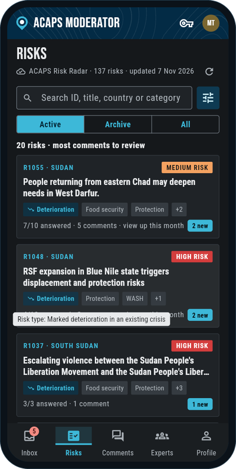
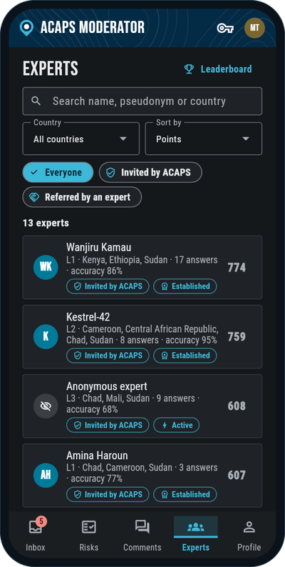
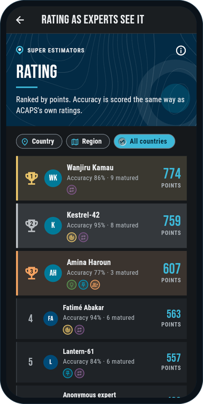

# Ground Truth: a trusted expert loop for ACAPS risk analysis

**Team Clankers** | **Hackathon for Good #8** | 6-8 November 2026 | The Hague | Challenge by [ACAPS](https://www.acaps.org/)

Ground Truth is a phone app that gives ACAPS a small, trusted, moderated network of humanitarian experts per country. In about **2 minutes per risk**, an expert:

1. **ground-truths** an ACAPS risk, trigger by trigger: agree or not, how bad it would be, and what ACAPS is missing;
2. gives **one scored forecast**: will this risk materialise within 6 months, on ACAPS's own probability scale;
3. sees an **anonymised, Delphi-style group view** and can change their answer in the next round.

Every forecast is scored against what really happened, so a track record builds up and **super estimators** emerge. Each expert chooses their own **anonymity level**, and individual contributions are never shown to the public. ACAPS moderators get the aggregated expert input next to their own assessment, review comments, and manage the panels. ACAPS still makes the forecast.

> **Live demo:** **https://timurkambarov.github.io/HFG8-ACAPS-Ground-Truth/**. On a computer the app runs inside a phone frame, at phone size; on a phone it fills the screen. It uses the real backend (Supabase accounts, invite codes, the live ACAPS Risk Radar).
> **Android:** the app is distributed as an APK, see [Build the APK](app/README.md#build-the-apk). Demo risk: **R1055** (mass returns from eastern Chad to West Darfur).

<p align="center">
  
  &nbsp;
  
  &nbsp;
  
</p>
<p align="center"><sub>Moderator: risks to review · the expert panel · the super estimator rating as experts see it</sub></p>

---

## How it meets ACAPS's criteria

Mapped to the MoSCoW list in [`docs/evaluation-criteria.md`](docs/evaluation-criteria.md).

| Priority | Criterion | How Ground Truth does it | Where |
|---|---|---|---|
| **Must** | Easy to use, a community experts come back to | A personal invite code (typed on the start screen, no link or app store needed) opens the sign-up form. A survey takes about 2 minutes (max 3 trigger screens + 1 forecast), with *Not now* and Undo. Experts see what ACAPS did with their input ("Marked useful", "Used in the analysis of R1048"), points, badges and colleagues they invited | [`app/lib/screens/survey.dart`](app/lib/screens/survey.dart), [`app/lib/screens/home.dart`](app/lib/screens/home.dart) |
| **Must** | Each expert controls their anonymity | Three levels: known to ACAPS, pseudonym to colleagues, fully anonymous. Level 3 deletes the real name. Levels 1-2 can also stay anonymous to colleagues from other countries. Experts log in with pseudonym + password, so no real email is needed. Every name in the app comes from one function, `displayName(expert, viewer)`, which is tested | [`app/lib/identity.dart`](app/lib/identity.dart), [`app/test/identity_test.dart`](app/test/identity_test.dart), [`app/tool/identity_check.dart`](app/tool/identity_check.dart) |
| **Must** | Contributions always anonymous to the public | Group results only from **3+ respondents**. Export for ACAPS has aggregates only: no comments, no names next to answers, no respondent countries. Experts choose per risk how to be credited if ACAPS publishes it (real name, pseudonym, anonymous). Invite codes record *that* they were used, never by whom | `minPanel` and `publicView` in [`app/lib/store.dart`](app/lib/store.dart) |
| **Should** | Sustained engagement over time | Every answer is a dated check-in, not an overwrite. Trend since the last ACAPS update ("Since 8 Oct: Medium → High · 3 of 5 experts changed their forecast"). Track record, matured forecasts with what happened, referral codes with progress | [`app/lib/store.dart`](app/lib/store.dart) (`trendOf`, `CheckIn`) |
| **Should** | Short, focused contributions | One forecast per risk instead of one per trigger; trigger questions are not scored and the comment is optional | [`app/lib/screens/survey.dart`](app/lib/screens/survey.dart) |
| **Should** | Small trusted groups (5-10 per country) | Closed panels per country. Sign-up only with a moderator's single-use `GT-…` invite code or a member's permanent `REF-…` referral code, checked by the server. Moderator inbox flags countries with fewer than 3 experts. Trust signals for moderators only: *Invited by ACAPS* / *Referred by an expert*, *New* / *Active* / *Established* | [`app/lib/screens/moderator.dart`](app/lib/screens/moderator.dart), [`app/lib/auth.dart`](app/lib/auth.dart) |
| **Should not** | Engagement metrics as the goal; AI chatbot feel | Points reward accuracy (Brier score) and comments ACAPS found useful, not time in the app. No chatbot: experts answer structured questions and read colleagues' comments | [`app/lib/store.dart`](app/lib/store.dart) (`Points`, `Award`) |
| **Could** | Super estimator scoreboard | Accuracy = 100 × (1 − Brier) per matured forecast. "Bar to beat": ACAPS's own ratings scored the same way. Top 3 by Brier become *Super estimator* | [`app/lib/screens/home.dart`](app/lib/screens/home.dart) |
| **Could** | Where experts agree and disagree, incl. geography | Group view with the median and spread, and **"No clear group view: opinions split"** when the middle half spans 2+ steps (ACAPS's 1, 1, 5, 5 example). Respondents split into experts from the risk country and from elsewhere; a *Who?* sheet on comments shows where agreeing and disagreeing experts are from. Moderators sort by *experts most split* and *disagreement with ACAPS*. Ranking by country or region | `GroupView` in [`app/lib/models.dart`](app/lib/models.dart), [`app/lib/screens/survey.dart`](app/lib/screens/survey.dart) |
| **Could** | Mobile and low bandwidth | Built for phones: an Android app (APK), and a web version that opens full screen on a phone (and in a phone frame on a computer). Portrait only, light vibration on choices, search stays above the keyboard. No images and no web fonts: ACAPS graphics are drawn in code and the two ACAPS typefaces are bundled (~120 KB). The last risks loaded stay on the device, so the app opens offline | [`app/lib/theme.dart`](app/lib/theme.dart), [`app/lib/brand.dart`](app/lib/brand.dart), [`app/web/`](app/web/) |
| **Could** | French and other languages | Not yet. Planned for the pilot | — |
| **Can** | AI behind the scenes for moderators | Not built on purpose for the hackathon: with 5-10 experts and a few short comments per risk, a moderator reads them in a minute, and expert comments should not leave Europe without a clear data agreement. Next step once panels grow: theme grouping of comments with links back to the source comments, minority views shown separately, moderator approves the draft | — |

### Use of the Risk Radar data

- The risks are ACAPS's **live Risk Radar**: [`scripts/sync_risks.dart`](scripts/sync_risks.dart) copies the ACAPS API into the Supabase `risks` table every week ([GitHub Action](.github/workflows/weekly-risk-sync.yml)), and the app reads that table (real titles, triggers, ACAPS probability, impact, risk level, categories and outcomes). The Risks tab shows the source and when it was last updated.
- The sync writes only what changed. A risk ACAPS closes (e.g. Active → Materialised) moves to the archive, and the forecasts already given on it get scored.
- Expert forecasts on **resolved risks are scored against what really happened**, and so are ACAPS's own ratings, so experts are compared with ACAPS on the same risks.
- Expert input goes back to ACAPS as JSON with the Risk Radar field names, so it can be joined to ACAPS's own data.

### Backend: Supabase

The app runs on **Supabase** ([`supabase/`](supabase/README.md)):

- Postgres schema for risks, triggers, profiles, invite and referral codes, responses per Delphi round, comments and votes, with **row-level security** on every table. Experts read only their own profile and answers; moderators read all.
- Sign-up only with a valid code, checked on the server. A fully anonymous profile never stores a real name.
- Views that compute each expert's Brier score next to ACAPS's on resolved risks.
- The app holds only the publishable key; the secret key is used only by the sync script.
- Accounts, codes, referrals and risks already live in Supabase. Answers, comments and points still run on demo data on the device (all experts are synthetic); the tables for them are ready.

---

## Repository structure

```
HFG8-ACAPS-Ground-Truth/
├── README.md                ← You are here: what we built and how it meets the criteria
├── app/                     ← THE APP (Flutter: Android APK + web). Start here
│   ├── lib/                 ← screens/, models, store (state), identity (anonymity rules), auth (Supabase accounts and codes), risk_source
│   ├── test/                ← anonymity rules, trigger parser, moderator smoke test (with a snapshot of the risks table)
│   ├── tool/                ← Supabase keys for `flutter run`, anonymity check
│   ├── android/             ← Android project (app ID, icon, release signing)
│   ├── web/                 ← web page: loading screen, phone frame on computers
│   └── run.ps1              ← starts the app with the Supabase keys
├── supabase/                ← Backend: SQL migrations (schema, row-level security, Brier views) and setup guide
├── scripts/                 ← sync_risks.dart: ACAPS Risk Radar API → Supabase
├── .github/workflows/       ← live demo on GitHub Pages; weekly risk sync
│
├── docs/                    ← Challenge brief, methodology, data dictionary, evaluation criteria (from ACAPS); screenshots
├── data/                    ← Risk Radar export, CSV + XLSX (from ACAPS)
└── references/              ← ACAPS methodology PDF and infographic
```

## Run it

| What | How |
|---|---|
| Live demo | https://timurkambarov.github.io/HFG8-ACAPS-Ground-Truth/ (add `?frame=off` for the full page on a computer) |
| Android APK | Build and sign it as in [`app/README.md` → Build the APK](app/README.md#build-the-apk), then share the `.apk` file |
| Run while developing | `./app/run.ps1 -Device <device-id>` with `SUPABASE_URL` and `SUPABASE_PUBLISHABLE_KEY` in the git-ignored `API.key` (Flutter 3.22+). In VS Code: *Run and Debug* → **app (phone)**. Details and tests: [`app/README.md`](app/README.md) |
| Log in as | First moderator: *I have a code* → `GT-ACAPS-MOD1`. Moderators then send single-use invite codes; each expert gets a `REF-…` referral code on their Profile |
| Update the risks | Automatic every Monday ([`weekly-risk-sync.yml`](.github/workflows/weekly-risk-sync.yml)), or by hand: `dart run scripts/sync_risks.dart` |
| Backend | See [`supabase/README.md`](supabase/README.md) |
| GitHub Actions setup | Repository secrets, listed at the top of [`deploy-demo.yml`](.github/workflows/deploy-demo.yml) and [`weekly-risk-sync.yml`](.github/workflows/weekly-risk-sync.yml) |

## What's next

- Answers, comments and points in Supabase too (the tables exist), so moderators see every expert's input in one place.
- An iOS version (the Flutter code is shared; it needs an Apple developer account to distribute).
- French and other working languages of field experts.
- Real push notifications and a vetting step for referred experts.
- AI support for moderators, as described in the criteria table.

---

# About the challenge

ACAPS analysts build the [Risk List](https://www.acaps.org/en/thematics/all-topics/risk-list): an overview of risks that could trigger a new humanitarian crisis or sharply worsen an existing one. But today, the knowledge of the experts closest to these crises — the people who sense a shift before it shows up in a report — stays locked in informal conversations and disappears.

**The challenge:** build a system that lets a trusted, moderated network of humanitarian experts challenge, enrich and forecast ACAPS risk analyses, while controlling their own anonymity and contributing in just a few minutes.

**Challenge owners:** Lars Peters and Alexander Harper, [ACAPS](https://www.acaps.org/), an independent humanitarian analysis organisation monitoring 100+ crises worldwide.

| Direction | What it means |
|-----------|---------------|
| **Ground Truthing** | Experts react to ACAPS risk analyses: do they agree? What is missing? Delphi-style: independent responses, anonymised group summary, iterative refinement. |
| **Forecasting** | Experts estimate how likely specific events are within six months. Track records emerge over time, surfacing "super estimators". |

Ground Truth covers both directions.

### The data

The ACAPS Risk Radar export contains **139 humanitarian risks** across **57 countries**, with the full lifecycle of each risk: the risk (title, type, country, triggers), the ACAPS rating (probability, impact, risk level, rationale) and what happened (status, materialisation description). Among resolved risks, about **84% of "High" risks materialised**. See the [data dictionary](docs/data-dictionary.md). The app uses the live Risk Radar API instead of this export (see above).

### Key constraints

- **Anonymity is non-negotiable.** Each expert controls their level: known to ACAPS, pseudonymous to peers, or fully anonymous. Contributions are always anonymous to the public.
- **Respect experts' time.** A contribution should take minutes, not hours.
- **Small trusted groups.** 5-10 experts per country/context, moderated by ACAPS.
- **No real personal data.** Synthetic users during the hackathon.

<p align="center">
  
</p>

### Resources

- [Full challenge brief](docs/challenge-brief.md) ([PDF](docs/challenge-brief.pdf)) · [Risk methodology](docs/risk-methodology.md) · [Data dictionary](docs/data-dictionary.md) · [Evaluation criteria](docs/evaluation-criteria.md) · [Resources and inspiration](docs/resources.md)
- [ACAPS Risk List](https://www.acaps.org/en/thematics/all-topics/risk-list) (live data) · [ACAPS API](https://api.acaps.org)

## License

MIT, see [LICENSE](LICENSE). ACAPS data is used under [ACAPS' terms of use](https://www.acaps.org/en/about/terms-of-use).
